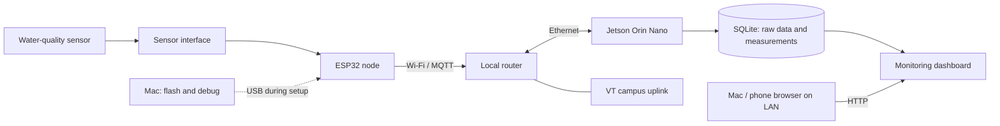

# Clam Factory Deployment

Real-time wastewater monitoring for a clam processing facility, built one sensor
board at a time. The longer-term research goal is multimodal estimation of
laboratory BOD₅ from water-quality measurements, images, and process context.

**Current milestone:** bring Node 01 dissolved oxygen and temperature data onto
a live monitoring dashboard over the local network.

**Status:** Node 01 v0.1.3 is running on hardware. User-provided serial logs confirm
UART0 diagnostics, Wi-Fi association, DHCP addressing, and periodic sensor polls.
User logs now confirm sensor_status=OK with DO, saturation, and temperature.
Jetson LAN address `192.168.88.250` is owner-confirmed. Clock synchronization,
live deployment of the new recorder/dashboard remains pending. Two actual Node 01
telemetry messages were received on Jetson over MQTT on 2026-11-06.
See the [Jetson MQTT setup](gateway/README.md) for the next step.

## Phase 1: monitor first

- One independently flashed ESP32 board per sensor node.
- Commission and verify one node before adding the next.
- Use a Mac for USB flashing and debugging.
- Use Wi-Fi for operational sensor telemetry; nodes can use independent power.
- Run the data receiver, storage, and dashboard on a Jetson Orin Nano connected
  to the router by Ethernet. A connected display is fine.
- Allow the Mac and other authorized devices on the LAN to view the dashboard.
- Preserve real readings and expose disconnected, stale, and invalid states.

Actuator control, BOD prediction, and VT branding are later milestones. Phase 1
does not include pump, valve, heater, or remote sampling-control interfaces.

## Architecture



Implementation baseline: Mosquitto for MQTT, Python for ingestion and the web
service, SQLite for storage, and HTML/CSS/JavaScript for the dashboard. Keep one
gateway codebase that can also be debugged on macOS. Add dependencies only when
needed for an implemented feature.

The Jetson must remain powered on for central recording and dashboard access.
The Mac does not need to remain attached to a sensor board. Internet access is
not the telemetry path; the node-to-gateway path is local.

## How MQTT data reaches the dashboard

MQTT is a publish/subscribe messaging protocol. **Mosquitto**, running on the
Jetson, is the MQTT broker: it accepts messages and forwards them to subscribed
clients. The router carries the network traffic; the broker runs on the Jetson.

1. Node 01 reads the DO probe over RS485 and decodes the measurements.
2. The ESP32 connects over Wi-Fi and publishes JSON about every five seconds
   to `clam/node_01/telemetry` on the broker at `192.168.88.250:1883`.
3. The Jetson receiver subscribes to `clam/+/telemetry` (`+` matches one node
   topic level), so additional nodes can use the same receiver.
4. The receiver will validate and store messages and gateway receive timestamps
   in SQLite. The web service will expose the stored readings to the dashboard.
5. Browsers will access the web service over HTTP; MQTT credentials stay out of
   frontend code.

The broker is a message relay, not the measurement database or dashboard.
MQTT delivery does not by itself prove a sample was saved. Node 01 also publishes
connection status to `clam/node_01/status`; sensor quality is a separate field
in telemetry. See [gateway setup](gateway/README.md) for commissioning commands.

**Progress (2026-11-06):** the owner confirmed Mosquitto is active and enabled at
boot after reinstalling Jetson. MQTT account/listener setup and Node 01 delivery are confirmed by two subscriber
messages. The Python/SQLite recorder and dashboard are implemented locally; follow
[dashboard setup](docs/dashboard_setup.md) to deploy and verify on Jetson.

### Which password is which?

| Credential | Purpose |
| --- | --- |
| Wi-Fi password | Connect ESP32 to the router's wireless network |
| Jetson login password | SSH login and `sudo` as the Linux user `lihong` |
| MQTT `clam_node_01` password | Authenticate the ESP32 to Mosquitto; planned ACL allows publishing its own telemetry/status |
| MQTT `clam_gateway` password | Authenticate the receiver to Mosquitto; planned ACL allows reading node telemetry/status |

The two MQTT accounts are broker accounts, not Linux login accounts. Set new,
separate MQTT passwords when prompted by `mosquitto_passwd`. A preceding
`[sudo] password for lihong:` prompt still asks for the Jetson login password.
Account permissions take effect after the broker authentication and ACL files
are configured. Keep actual passwords only in local ignored configuration.

SSH lets a person operate the Jetson from a Mac; MQTT lets sensor nodes send
messages automatically. Neither requires keeping the ESP32 attached to the Mac.

## Node map

Node numbers follow this project's sensor plan, not the older shrimp project's
numbering. One ESP32 node means one independently flashed board. A camera is a
separate acquisition device; slot 06 is reserved without assuming an ESP32.

| Slot / device ID | Measurement | Current state |
| --- | --- | --- |
| 01 / `node_01` | Dissolved oxygen + temperature; saturation if supported | First implementation; confirm actual board and probe |
| 02 / `node_02` | ORP + temperature if supported | Planned |
| 03 / `node_03` | pH | Planned |
| 04 / `node_04` | Turbidity | Planned |
| 05 / `node_05` | Electrical conductivity (EC) | Planned; sensor model and wiring to confirm |
| 06 / `camera_06` | RGB images | Reserved; interface and hardware to confirm |
| 07 / `node_07` | UV254 / optical COD proxy | Provisional; hardware not selected |

Flow, level, and fluorescence have been discussed but are not assigned to
additional nodes. Confirm additions before changing this map. A sensor's
calculated COD or BOD output is a proxy, not a laboratory reference label.

## Network identity and sequential IP addresses

Use DHCP on the boards and reserve addresses by each board's Wi-Fi station MAC
in the router (the router's **Make Static** / address reservation action).
Firmware identity stays `node_01`, `node_02`, etc., regardless of IP address.
Use unique MQTT client IDs and the `clam/` topic namespace to avoid collisions
with any existing shrimp deployment on the same gateway.

Agreed node addressing: `192.168.88.(100 + node number)`. Configure each
reservation on the router as its board is commissioned; firmware continues to
use DHCP.

| Device | Reserved / planned address | Status |
| --- | --- | --- |
| Node 01 | `192.168.88.101` | Active lease verified in WebFig after board reset (2026-11-04) |
| Node 02 | `192.168.88.102` | Confirmed in serial diagnostics (2026-11-10) |
| Node 03 | `192.168.88.103` | Planned |
| Node 04 | `192.168.88.104` | Planned |
| Node 05 | `192.168.88.105` | Planned |
| Slot 06 / camera | `192.168.88.106` | Reserved in plan; camera network configuration pending |
| Node 07 | `192.168.88.107` | Planned |

The Jetson reservation is `192.168.88.250`; its active address is owner-confirmed; broker service
still needs verification. Check leases and existing static assignments before
allocating each remaining node address. Node 01's previous dynamic address was
`.253`; no firmware change is needed for the new router reservation.

See [LAN address reservations](docs/network_setup.md) for the WebFig steps,
why a board reset helps, and how to verify the active address.

For each board:

1. Flash its node-specific firmware and connect it to the router's sensor Wi-Fi.
2. Read its station MAC and assigned IP from the startup diagnostics.
3. Match that MAC to the router lease and reserve the next agreed address.
4. Renew the lease or restart the board; verify the reserved IP is in use.
5. Record the node ID, board label, MAC, IP, firmware version, and result in a
   local commissioning record, then move to the next board.

The gateway's broker address is local firmware configuration. Changing a node's
reservation does not change its node ID or require a firmware rebuild. Changing
the broker address may require updating firmware configuration.

Both wired and wireless clients must be able to reach the gateway. A shared VT
campus uplink does not establish LAN reachability: verify the actual subnet,
client isolation, and broker/web access. Confirm the router's 2.4 GHz sensor
Wi-Fi configuration. Initial access is LAN-only, with no public port forwarding.
Use authenticated MQTT; keep Wi-Fi and broker credentials out of Git.

## Repository organization

Create each implementation directory when its first working component is added:

```text
README.md                          Overall architecture, node map, milestone status
monitoring_nodes/
  node_01/README.md                Node 01 hardware and commissioning notes (present)
  node_01/firmware/node_01_do/     DO-only Arduino sketch and configuration template
  node_01/tests/                   Host-side sensor protocol checks
  node_02/ ... node_07/            Add node folders as hardware is commissioned
gateway/                           Python MQTT receiver, SQLite storage, HTTP service
web/                               HTML/CSS/JavaScript monitoring dashboard
```

The camera's implementation folder will follow its confirmed hardware type.
Directory `monitoring_nodes/node_01` matches data identity `node_01`. Keep each node's exact
parts, wiring, firmware settings, build/upload steps, and verification results
together. Do not copy the old project's logs, secrets, board MACs, or databases.

## Data and dashboard requirements

The first implementation should preserve:

- Node ID, sensor model, firmware version, boot ID, and sequence number.
- Sample UTC when synchronized; otherwise `null` with an explicit unsynchronized
  flag, plus device uptime. Never substitute arrival time for sample time.
- Gateway receive UTC, original sensor response, parsed values, and units.
- Sensor/communication quality separately from node connectivity and data age.

Use `(node_id, boot_id, sequence)` to distinguish reboots and deduplicate
retransmitted samples. Missing or invalid measurements remain missing, not zero.
Mark chart gaps and stale values. Network recovery must not manufacture samples
for an outage; offline buffering guarantees will be documented when implemented.

The dashboard will use an English, dark industrial monitoring layout with clear
typography, restrained accent colors, and responsive charts. Its first view must
show Node 01 values, units, recent trends, last update time, and connectivity.
Do not use color alone for status. Demo data, if used during UI development,
must be visibly labeled and kept separate from real measurements.

Frontend design guidance: `frontend-design` for visual composition,
`web-design-guidelines` for UI review, and `ui-ux-pro-max` for targeted design
references. These are developer skills, not runtime dependencies.

## First-node acceptance sequence

1. Confirm the actual board, DO sensor, converter, supply, and pin assignment.
2. Build the firmware and verify sensor decoding against protocol examples.
3. Flash only the identified Node 01 and inspect real sensor responses over USB.
4. Join Wi-Fi, reserve its IP, and verify MQTT delivery to the gateway.
5. Confirm stored records and dashboard readings match the actual sensor data.
6. Power the board independently and confirm telemetry continues without a USB
   connection to the Mac or Jetson.
7. Disconnect/reconnect Wi-Fi and restart the node and gateway; check recovery,
   stale display, timestamp handling, and recorded gaps.

Document actual results before marking any step complete. A live chart proves
the acquisition path, not sensor calibration or analytical accuracy. There are
manual build and upload commands in the [Node 01 guide](monitoring_nodes/node_01/README.md).
The first bench firmware has no offline queue; use its counters to detect loss
and add durable buffering before unattended research recording.

## Later milestones

- Commission ORP, pH, turbidity, and the remaining confirmed instruments.
- Integrate camera images with timestamps and measurement-location metadata.
- Record paired laboratory BOD₅ samples by sampling time/window and sample ID.
- Compare sensor-only and multimodal BOD₅ models on held-out dates/batches.
- Add separately specified controls and VT branding.

## References

- [hardware_record_tank](https://github.com/LihongYang99/hardware_record_tank):
  reference implementation, not a drop-in configuration for this site.
- [Node 01 preparation](monitoring_nodes/node_01/README.md).
- [DFRobot SEN0681 protocol](https://wiki.dfrobot.com/sen0681/docs/21674):
  candidate DO sensor inherited from the earlier hardware records.

The older project used different node assignments and had different deployment
requirements. This project's agreed gateway is the Jetson Orin Nano.
