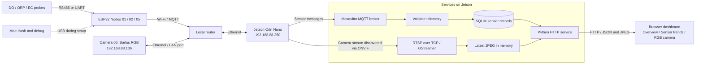

# Clam Factory Deployment

Real-time wastewater monitoring for a clam processing facility, built one sensor
board at a time. The longer-term research goal is multimodal estimation of
laboratory BOD₅ from water-quality measurements, images, and process context.

**Current milestone:** operate a shared monitoring dashboard for sensor telemetry
and live camera previews on the Jetson Orin Nano.

**Status (updated November 13, 2026):** Node 01 DO/temperature, Node 02
ORP/temperature, and Node 05 EC/estimated salinity have delivered real telemetry
to the deployed gateway and dashboard. Calibration and compensation remain
unverified. Camera 06 has supplied real images to the RGB camera page and the
Overview preview. Its static address was changed to `192.168.88.106` on November
12; the gateway stream configuration was updated, and a service restart was
requested. Post-change stream recovery has not yet been verified.

See [dashboard setup](docs/dashboard_setup.md), [MQTT setup](gateway/README.md),
and [camera setup](docs/camera_setup.md) for operation and troubleshooting.

## Phase 1: monitor first

- One independently flashed ESP32 board per sensor node.
- Commission and verify one node before adding the next.
- Use a Mac for USB flashing and debugging.
- Use Wi-Fi for operational sensor telemetry; nodes can use independent power.
- Run the data receiver, storage, and dashboard on a Jetson Orin Nano connected
  to the router by Ethernet. A connected display is fine.
- Allow the Mac and other authorized devices on the LAN to view the dashboard.
- Preserve real readings and expose disconnected, stale, and invalid states.

Actuator control and trained BOD prediction are later milestones. The dashboard
already includes VT and company branding and a prediction-results placeholder.
Phase 1 does not include pump, valve, heater, or remote sampling-control interfaces.

## Architecture



Camera images use a separate RTSP acquisition path, not MQTT. The Overview has a
small live preview; the RGB camera page shows the larger image. The gateway
keeps only the latest JPEG in memory, and the browser refreshes it every two
seconds. Frames older than ten seconds are unavailable rather than displayed as
live. Images and video are **not currently archived in SQLite or on disk**.
Frame timestamps are gateway receive times, not verified camera exposure times.

Implementation baseline: Mosquitto for MQTT, Python for ingestion and the web
service, SQLite for storage, and HTML/CSS/JavaScript for the dashboard. Keep one
gateway codebase for telemetry and web development on macOS and deployment on
Jetson. Camera decoding uses the Jetson system Python and GStreamer bindings.
Add dependencies only when needed for an implemented feature.

The Jetson must remain powered on for central recording and dashboard access.
The Mac does not need to remain attached to a sensor board. Internet access is
not the telemetry path; the node-to-gateway path is local.

## How MQTT data reaches the dashboard

MQTT is a publish/subscribe messaging protocol. **Mosquitto**, running on the
Jetson, is the MQTT broker: it accepts messages and forwards them to subscribed
clients. The router carries the network traffic; the broker runs on the Jetson.

1. Node 01 reads the DO probe over RS485 and decodes the measurements.
2. The ESP32 connects over Wi-Fi and publishes JSON about every five seconds
   to `clam/node_01/telemetry` on the broker at `192.168.88.250:1883`.
3. The Jetson receiver subscribes to `clam/+/telemetry` (`+` matches one node
   topic level), so additional nodes can use the same receiver.
4. The receiver validates and stores messages and gateway receive timestamps
   in SQLite. The web service exposes the stored readings to the dashboard.
5. Browsers access the web service over HTTP; MQTT credentials stay out of
   frontend code.

The broker is a message relay, not the measurement database or dashboard.
MQTT delivery does not by itself prove a sample was saved. Node 01 also publishes
connection status to `clam/node_01/status`; sensor quality is a separate field
in telemetry. See [gateway setup](gateway/README.md) for commissioning commands.

The MQTT broker, Python/SQLite recorder, and HTTP dashboard are deployed on the
Jetson. Nodes 01, 02, and 05 use the same ingestion path. A successful connection
does not establish measurement accuracy; retain each node's quality flags.

### Which password is which?

| Credential | Purpose |
| --- | --- |
| Wi-Fi password | Connect ESP32 to the router's wireless network |
| Jetson login password | SSH login and `sudo` as the Linux user `lihong` |
| MQTT `clam_node_01`, `clam_node_02`, or `clam_node_05` password | Authenticate the corresponding ESP32; each account may publish only its own telemetry/status |
| MQTT `clam_gateway` password | Authenticate the receiver; its ACL permits reading node telemetry/status |

These MQTT accounts are broker accounts, not Linux login accounts. Set new,
separate MQTT passwords when prompted by `mosquitto_passwd`. A preceding
`[sudo] password for lihong:` prompt still asks for the Jetson login password.
Account permissions take effect after the broker authentication and ACL files
are configured. Keep actual passwords only in local ignored configuration.

SSH lets a person operate the Jetson from a Mac; MQTT lets sensor nodes send
messages automatically. Neither requires keeping the ESP32 attached to the Mac.

## Node map

Node numbers follow this project's sensor plan, not the older shrimp project's
numbering. One ESP32 node means one independently flashed board. A camera is a
separate Ethernet acquisition device in slot 06; it does not use an ESP32.

| Slot / device ID | Measurement | Current state |
| --- | --- | --- |
| 01 / [node_01](monitoring_nodes/node_01/README.md) | Dissolved oxygen + temperature + oxygen saturation (SEN0681) | Live telemetry and dashboard; calibration/compensation unverified |
| 02 / [node_02](monitoring_nodes/node_02/README.md) | ORP + temperature (SEN0709) | Live telemetry and dashboard; calibration/compensation unverified |
| 03 / `node_03` | pH | Planned |
| 04 / `node_04` | Turbidity | Planned |
| 05 / [node_05](monitoring_nodes/node_05/README.md) | Electrical conductivity + estimated salinity (Atlas EZO-EC, K10) | Firmware 0.1.4; MQTT and dashboard verified; calibration/compensation unverified |
| 06 / [camera_06](docs/camera_setup.md) | RGB images (Barlus IPC5MPIR-PBX10) | Live preview implemented; new-IP stream recovery pending verification |
| 07 / `node_07` | UV254 / optical COD proxy | Provisional; hardware not selected |

Flow, level, and fluorescence have been discussed but are not assigned to
additional nodes. Confirm additions before changing this map. A sensor's
calculated COD or BOD output is a proxy, not a laboratory reference label.

## Network identity and sequential IP addresses

Use DHCP on the boards and reserve addresses by each board's Wi-Fi station MAC
in the router (the router's **Make Static** / address reservation action).
Firmware identity stays `node_01`, `node_02`, etc., regardless of IP address.
Use unique MQTT client IDs and the `clam/` topic namespace to avoid collisions
with any existing shrimp deployment on the same gateway.

Agreed node addressing: `192.168.88.(100 + node number)`. Configure each
reservation on the router as its board is commissioned; firmware continues to
use DHCP.

| Device | Assigned / planned address | Status |
| --- | --- | --- |
| Node 01 | `192.168.88.101` | Active lease verified in WebFig after board reset (2026-11-04) |
| Node 02 | `192.168.88.102` | Confirmed in serial diagnostics (2026-11-10) |
| Node 03 | `192.168.88.103` | Planned |
| Node 04 | `192.168.88.104` | Planned |
| Node 05 | `192.168.88.105` | Planned; identified MAC `44:1B:F6:FE:71:50`, reservation pending |
| Slot 06 / camera | `192.168.88.106` | Static IP configured on camera; MAC `00:12:35:02:DF:76`; router DHCP exclusion/reservation pending |
| Node 07 | `192.168.88.107` | Planned |

The Jetson reservation is `192.168.88.250`; gateway and broker operation have been
verified. Camera 06 uses a camera-configured static IP, rather than board DHCP.
Reserve/exclude `.106` in the router DHCP configuration to prevent a future
conflict. Node 05 was last observed at dynamic address `192.168.88.97` on
November 12, 2026; `.105` is not yet confirmed. Check leases and existing static
assignments before allocating each remaining node address. Node 01's previous
dynamic address was `.253`; no firmware change is needed for the new router
reservation.

See [LAN address reservations](docs/network_setup.md) for the WebFig steps,
why a board reset helps, and how to verify the active address.

For each board:

1. Flash its node-specific firmware and connect it to the router's sensor Wi-Fi.
2. Read its station MAC and assigned IP from the startup diagnostics.
3. Match that MAC to the router lease and reserve the next agreed address.
4. Renew the lease or restart the board; verify the reserved IP is in use.
5. Record the node ID, board label, MAC, IP, firmware version, and result in a
   local commissioning record, then move to the next board.

The gateway's broker address is local firmware configuration. Changing a node's
reservation does not change its node ID or require a firmware rebuild. Changing
the broker address may require updating firmware configuration.

Both wired and wireless clients must be able to reach the gateway. A shared VT
campus uplink does not establish LAN reachability: verify the actual subnet,
client isolation, and broker/web access. Confirm the router's 2.4 GHz sensor
Wi-Fi configuration. The web service listens on the project LAN, with no public
port forwarding. For home access, use the VT VPN and an SSH tunnel through the
Jetson's campus address, opening `http://localhost:8001` on the Mac; see
[connection tips](tips.md). Use authenticated MQTT and keep credentials out of Git.

## Repository organization

Implemented components are organized as follows; add other node directories
when their hardware is commissioned:

```text
README.md                          Architecture, node map, and milestone status
monitoring_nodes/
  node_01/                        DO firmware, protocol tests, and commissioning guide
  node_02/                        ORP firmware, protocol tests, and commissioning guide
  node_05/                        EC/salinity firmware, tests, and commissioning guide
gateway/                          MQTT receiver, SQLite storage, and HTTP service
  camera.py                       RTSP acquisition and latest-JPEG worker
web/                              HTML/CSS/JavaScript monitoring dashboard
docs/                             Network, dashboard, camera, and prediction guides
tips.md                           Everyday commands and remote-access instructions
```

Camera decoding is implemented in `gateway/camera.py`; see
[Camera 06 setup](docs/camera_setup.md). Its private RTSP URL stays in
`gateway/.env` and is never sent to the browser.
Directory `monitoring_nodes/node_01` matches data identity `node_01`. Keep each
node's exact parts, wiring, firmware settings, build/upload steps, and
verification results together. Do not copy the old project's logs, secrets, board MACs, or databases.

## Data and dashboard requirements

The sensor data contract preserves:

- Node ID, sensor model, firmware version, boot ID, and sequence number.
- Sample UTC when synchronized; otherwise `null` with an explicit unsynchronized
  flag, plus device uptime. Never substitute arrival time for sample time.
- Gateway receive UTC, original sensor response, parsed values, and units.
- Sensor/communication quality separately from node connectivity and data age.

Use `(node_id, boot_id, sequence)` to distinguish reboots and deduplicate
retransmitted samples. Missing or invalid measurements remain missing, not zero.
Mark chart gaps and stale values. Network recovery must not manufacture samples
for an outage; offline buffering guarantees will be documented when implemented.

The dashboard uses English, a white background, deep blue text, Calibri with
system fallbacks, and responsive charts. Overview groups chemical properties,
physical properties, and image information. Sidebar pages provide sensor trends,
source temperatures and their valid-reading average, RGB preview, IP & MAC
records, and a prediction-results placeholder for DO, ORP, and source-specific
temperatures 12 hours ahead. The intended prediction cadence is hourly; no
trained LSTM or hourly inference task is deployed yet. BOD₅ estimation remains
a separate research milestone.
Do not use color alone for status. Demo data, if used during UI development,
must be visibly labeled and kept separate from real measurements.

Frontend design guidance: `frontend-design` for visual composition,
`web-design-guidelines` for UI review, and `ui-ux-pro-max` for targeted design
references. These are developer skills, not runtime dependencies.

## First-node acceptance sequence

1. Confirm the actual board, DO sensor, converter, supply, and pin assignment.
2. Build the firmware and verify sensor decoding against protocol examples.
3. Flash only the identified Node 01 and inspect real sensor responses over USB.
4. Join Wi-Fi, reserve its IP, and verify MQTT delivery to the gateway.
5. Confirm stored records and dashboard readings match the actual sensor data.
6. Power the board independently and confirm telemetry continues without a USB
   connection to the Mac or Jetson.
7. Disconnect/reconnect Wi-Fi and restart the node and gateway; check recovery,
   stale display, timestamp handling, and recorded gaps.

Document actual results before marking any step complete. A live chart proves
the acquisition path, not sensor calibration or analytical accuracy. There are
manual build and upload commands in the [Node 01 guide](monitoring_nodes/node_01/README.md).
The first bench firmware has no offline queue; use its counters to detect loss
and add durable buffering before unattended research recording.

## Later milestones

- Complete calibration verification and commission pH, turbidity, and remaining instruments.
- Add timestamped image archiving and align images with sensor sampling windows.
- Record paired laboratory BOD₅ samples by sampling time/window and sample ID.
- Compare sensor-only and multimodal BOD₅ models on held-out dates/batches.
- Add separately specified controls when the monitoring phase is complete.

## References

- [Camera 06 setup](docs/camera_setup.md): network, ONVIF/RTSP acquisition, preview, and recovery.
- [hardware_record_tank](https://github.com/LihongYang99/hardware_record_tank):
  reference implementation, not a drop-in configuration for this site.
- [Node 01 commissioning](monitoring_nodes/node_01/README.md).
- [Node 02 commissioning](monitoring_nodes/node_02/README.md): ORP acquisition and calibration troubleshooting.
- [Node 05 EC commissioning](monitoring_nodes/node_05/README.md): UART wiring,
  board identification, build/upload, MQTT account, and verification.
- [DFRobot SEN0681 protocol](https://wiki.dfrobot.com/sen0681/docs/21674):
  installed DO probe model confirmed by the operator.

The older project used different node assignments and had different deployment
requirements. This project's agreed gateway is the Jetson Orin Nano.
